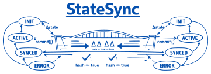

# [sync-state-bridge](https://github.com/akingdom/sync-state-bridge/)

A deterministic, race‑safe state synchronisation bridge for real‑time applications, with built‑in QoS, backpressure handling, and network resilience.

- **Versioned, per‑type sync** – each entity type has its own version history.
- **Segmented deltas** – send only what changed, with a manifest first.
- **FSM lifecycle** – correct handling of add→update→delete sequences.
- **Resilient reconnection** – out‑of‑order drop, monotonicity guards, schema mismatch handling.
- **Quality of Service (QoS)** – three priority levels (CRITICAL, CONFLATABLE, BEST_EFFORT).
- **Adaptive backpressure** – the Governor monitors queue depth and recommends throttling.
- **Pure Python + JS** – no binary dependencies.
- **Pluggable transports** – IPC, HTTP/SSE, and more.

## Quick Start

Install the server package:

```bash
pip install sync-state-bridge
```

For optional features (faster JSON, serial transport):

```bash
pip install sync-state-bridge[fast,serial]
```

### Basic Usage (Simple Server with StateSync)

```python
from sync_state import StateSync, Presets

sync = StateSync()

# Register a snapshot provider with a QoS profile
sync.register_snapshot_provider(
    "vehicles",
    get_vehicles,
    qos=Presets.low_bandwidth()   # optimised for slow links
)

# After changes:
sync.mark_dirty("vehicles")
await sync.commit()

# Stream deltas over HTTP (SSE)
from fastapi import FastAPI, StreamingResponse
app = FastAPI()

@app.get("/stream")
async def stream(versions: str = "{}"):
    return StreamingResponse(
        sync.stream_deltas(json.loads(versions)),
        media_type="text/event-stream"
    )
```

### Advanced Full‑Stack Example (Gateway + Worker)

For a production‑grade setup with separate gateway and worker processes, see the [advanced_game example](https://github.com/akingdom/sync-state-bridge/edit/main/examples/advanced-game/). It demonstrates:

- **Router** – pure frame forwarder.
- **SynchronisationKernel** – priority queue and backpressure.
- **Governor** – adaptive health monitoring.
- **HTTPSSETransport** – web interface.
- **IPCTransport** – communication between gateway and worker.

#### Gateway (game_server.py)

```python
from sync_state.core.sync_bridge import SyncStateBridge
from sync_state.core.ipc_transport import IPCTransport
from sync_state.web import HTTPSSETransport

bridge = SyncStateBridge()
ipc = IPCTransport(listen_on="127.0.0.1:8766")
http = HTTPSSETransport(host="127.0.0.1", port=8000, static_dir="static")

bridge.register_transport(ipc, type_list=["player"], direction="in")
bridge.register_transport(http, type_list=["player"], direction="out", qos_map={"player": 3})

bridge.start()
http.start()
```

#### Worker (game_worker.py)

```python
from sync_state.core import StateSync
from sync_state.core.ipc_transport import IPCTransport

state_sync = StateSync()
# register snapshot providers...
ipc = IPCTransport(connect_to="127.0.0.1:8766")
# read frames, update state, commit, send deltas.
```

### Socket Server (for low‑level IPC)

```python
from sync_state.reliability import StateSyncSocketClient

client = StateSyncSocketClient(
    host="127.0.0.1",
    port=8765,
    on_delta_callback=handle_delta
)
await client.connect_and_listen()
```

## Quality of Service (QoS)

Each entity type can have a QoS profile:

| Policy        | Behaviour |
|---------------|-----------|
| `CRITICAL`    | Never dropped; queued until delivered. |
| `CONFLATABLE` | Intermediate deltas dropped; only the latest is sent. |
| `BEST_EFFORT` | Discarded immediately under queue pressure. |

Pre‑configured profiles (`Presets.conservative()`, `Presets.low_bandwidth()`, `Presets.high_throughput()`) are provided.

## Scope and Ordering

`sync-state-bridge` provides **versioned convergence for abstract key-value state**.
It versions deltas per entity type, applies QoS policies per type, and recovers
from disconnection via version vectors and snapshot providers.

### What SSB provides

- Per-entity-type monotonic versioning
- Segmented deltas (manifest + changed payload)
- add / update / delete FSM with deterministic transitions
- QoS delivery policies: CRITICAL, CONFLATABLE, BEST_EFFORT
- Bounded backpressure with priority snapshot injection
- Reconnection via version vector and snapshot recovery
- Pluggable IPC / SSE / socket transports

### What SSB does **not** provide

SSB does **not** provide ordering for **sequence state** or **spatial state**.
Specifically:

- **Text sequences** (character-level editing) require an OT log or a sequence
  CRDT (e.g. RGA). SSB can version a text field as an opaque property, but it
  cannot merge concurrent character inserts without loss.
- **Ordered lists** require fractional indexing or an equivalent order-maintenance
  structure. SSB can version an `index` property on each item, but it does not
  allocate, compare, or repair indices.
- **Chat / event logs** require a temporal sequence log with causal ordering.
  SSB versions individual messages as entities; it does not order the stream.
- **Spatial coordinates** are versioned as ordinary properties; SSB applies no
  spatial merge semantics.

### What this means for callers

If your domain has **only** abstract state (registers, maps, sets, counters,
properties on identified entities), SSB is sufficient on its own.

If your domain has **sequence or spatial state**, you must pair SSB with a
**positional layer** chosen for your domain:

| State kind | Companion mechanism |
| :--- | :--- |
| Character-level text, server-ordered | Operational Transformation (OT) |
| Character-level text, offline-capable | Sequence CRDT (RGA) |
| Ordered lists with stable IDs | Fractional indexing |
| Append-only event streams | Temporal log + sequence cursor |
| High-frequency spatial state | Snapshot interpolation (SSB is too coarse) |

The **positional layer owns ordering**. SSB owns **convergence of the abstract
state around it**. The two are complementary, not substitutes, and every
production system examined (Google Docs, Figma, Notion, Linear, Liveblocks,
Ably, Riot, multiplayer game servers) uses both in some form.

## Advanced Features

### QoS‑Aware Priority Queue

The `PriorityQoSQueue` provides three tiers with automatic eviction.

### Adaptive Governor

The Governor monitors queue depth and drop rates, providing recommendations to the application (e.g., `max_particles`, `max_asteroids`).

### Snapshot Chunking

Large snapshots are split into 64 KB chunks for reliable transmission.

```python
from sync_state.reliability import chunk_snapshot, SnapshotReassembler

chunks = chunk_snapshot(state, "snap_123")
reassembler = SnapshotReassembler()
for chunk in chunks:
    reassembler.ingest_chunk(chunk)
```

## Testing

Run the unit tests:

```bash
pytest tests/
```

The test suite covers:
- Deterministic hashing (`canonical_hash`)
- Commit & delta generation
- Version‑gap full‑snapshot recovery
- Router, Kernel, and QoS logic

## Demos

Run the demos:

- [**Chat**](https://github.com/akingdom/sync-state-bridge/edit/main/examples/chat/) – real‑time message broadcast with shared history.
```bash
cd examples/chat && python server.py
```

- [**Simple Game**](https://github.com/akingdom/sync-state-bridge/edit/main/examples/simple-game/) – turn‑based game using StateSync.
```bash
cd examples/simple-game && python server.py
```

- [**Advanced Game**](https://github.com/akingdom/sync-state-bridge/edit/main/examples/advanced-game/) – spaceship game with adaptive QoS and monitoring (the most comprehensive demo).
```bash
cd examples/advanced-game && python game_start.py
```

These run on a local server, displayed in the web browser (at `http:loopback:8000` by default). Proof of this is that you can refresh or close+reopen the browser window and it is still running.

## Protocol

See [`PROTOCOL.md`](https://github.com/akingdom/sync-state-bridge/edit/main/PROTOCOL.md) for the full SSE‑based delta protocol and the router/kernel design.

## License

MIT
